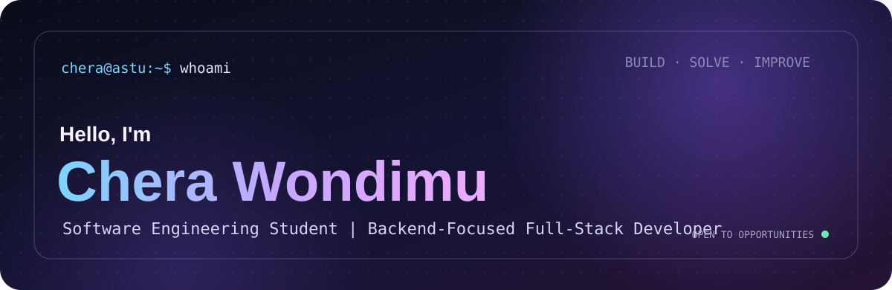
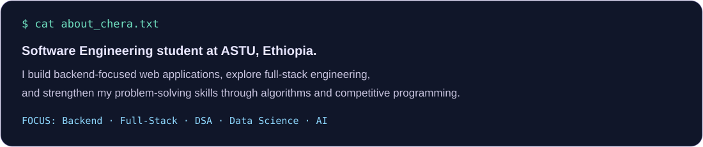
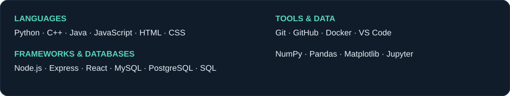
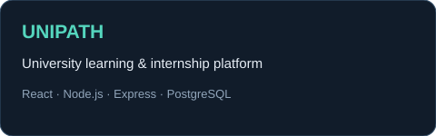
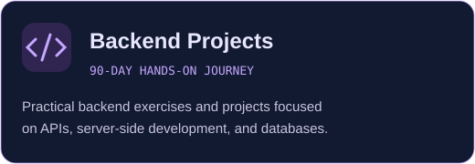
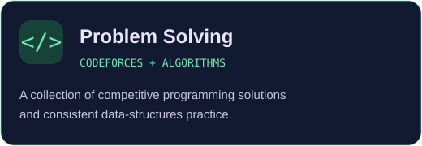

<!-- =====================================================
     CHERA WONDIMU | GITHUB PROFILE README
====================================================== -->

<!-- ANIMATED BANNER -->

  

<!-- ANIMATED TYPING INTRODUCTION -->

  

<!-- SOCIAL LINKS -->

  
  
  
  
  

---

<!-- ABOUT ME -->

  

  

  I'm a third-year Software Engineering student at
  <b>Adama Science and Technology University (ASTU)</b>, Ethiopia.

  I enjoy building software, solving algorithmic problems, and turning ideas into practical applications.
  My primary focus is backend development, while continuously growing as a full-stack developer.

  <b>Currently focusing on:</b> 
  Backend Engineering · Full-Stack Development · Data Structures & Algorithms · Data Science · Artificial Intelligence

---

<!-- TECHNICAL TOOLBOX -->

  

  

  <b>Programming Languages</b> 
  Python · C++ · Java · JavaScript · HTML · CSS

  <b>Frameworks and Technologies</b> 
  Node.js · Express.js · React

  <b>Databases</b> 
  PostgreSQL · MySQL · SQL

  <b>Data Science</b> 
  NumPy · Pandas · Matplotlib · Scikit-learn

  <b>Tools and Development Environment</b> 
  Git · GitHub · Docker · VS Code

---

<!-- FEATURED PROJECTS -->

  

  
  
  

### Featured Work

**1. [UniPath — University Learning and Internship Platform](https://github.com/Chera-Wondimu/university-learning-and-internship-platform)**

A platform designed to connect university students with learning resources and internship opportunities. It includes student and recruiter functionality.

**2. [Backend Development — 90 Days of Projects](https://github.com/Chera-Wondimu/backend-development-90-days-projects)**

A hands-on learning journey focused on backend engineering, server-side programming, APIs, databases, and practical implementation.

**3. [Competitive Programming Practice](https://github.com/Chera-Wondimu/CSEC-CPD-PRACTICE)**

A collection of algorithmic problem-solving exercises and solutions, primarily using Python, with a focus on improving computational thinking.

---

<!-- COMPETITIVE PROGRAMMING -->

  

  I continuously improve my problem-solving skills through competitive programming and algorithmic challenges.

  <a href="https://leetcode.com/u/Chera_Wondimu/">
    <b>LeetCode Profile</b>
  </a>
  &nbsp; • &nbsp;
  <a href="https://codeforces.com/profile/chera.wondimu17">
    <b>Codeforces Profile</b>
  </a>

  

---

<!-- GITHUB STATISTICS -->

  

  
  

  

---

<!-- ANIMATED CONTRIBUTION SNAKE -->

  

---

<!-- CONTACT -->

  <b>Let's connect and build something meaningful.</b>

  Interested in software engineering opportunities, internships, collaboration, or building projects together?

  <a href="mailto:chera.wondimu17@gmail.com">
    <b>Contact me: chera.wondimu17@gmail.com</b>
  </a>

<!-- PERSONAL MOTTO -->

  <i>"Waan jalqabde xumuri. Waan baratte ijaari. Waan ijaarte agarsiisi. Waan dogoggorte irraa baradhu. Sana irra deebi'i."</i>

<!-- FOOTER -->

  

